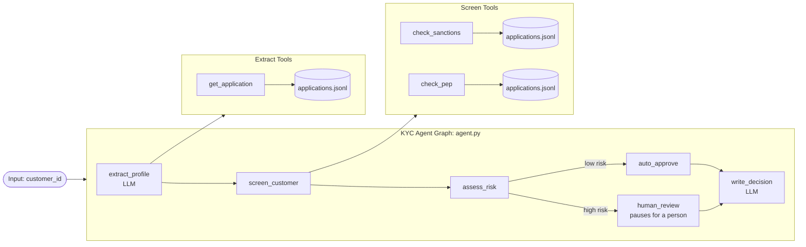

# KYC Onboarding Workshop

A hands-on tutorial for learning LangGraph by building a KYC (Know Your Customer) onboarding agent. The agent
checks a new bank customer the way a KYC analyst would:

1. Pulls the customer's details out of their application.
2. Screens them against sanctions and PEP (Politically Exposed Person) lists.
3. Scores their risk.
4. Sends high-risk customers to a human reviewer.
5. Writes a decision memo.

**Level:** 101 - Introduction to LangGraph.

## Architecture



| Node | What it does | Reads from state | Writes to state |
|------|--------------|------------------|-----------------|
| `extract_profile` | Looks up the application and has an LLM pull out the customer's details | `customer_id` | `application`, `profile` |
| `screen_customer` | Checks the name against the sanctions and PEP lists | `profile` | `screening_hits` |
| `assess_risk` | Any watchlist hit means high risk, otherwise low | `screening_hits` | `risk_level`, `risk_reasons` |
| `auto_approve` | Approves low-risk customers with no human involved | | `decision`, `reviewer`, `reviewer_notes` |
| `human_review` | Pauses with `interrupt()` until a compliance officer answers | `profile`, `risk_reasons` | `decision`, `reviewer`, `reviewer_notes` |
| `write_decision` | Has an LLM write a short memo for the audit file | the profile, hits, risk and decision fields | `decision_memo` |

NOTE: `route_on_risk` is a routing function that picks `human_review` or `auto_approve` after `assess_risk`.

| Tool | File | Reads | Returns |
|------|------|-------|---------|
| `get_application` | `tools/applications.py` | `data/applications.jsonl` | The customer's application text |
| `check_sanctions` | `tools/screening.py` | `data/sanctions_list.jsonl` | Sanctions entries whose name closely matches |
| `check_pep` | `tools/screening.py` | `data/pep_list.jsonl` | PEP entries whose name closely matches |

### Schemas

All of these are defined at the top of `agent.py`:

| Class | Kind | Purpose |
|-------|------|---------|
| `AgentInput` | dataclass | The graph's input: just `customer_id` |
| `AgentState` | dataclass | The shared case file that every node reads and updates. Read fields as attributes, for example `state.customer_id` |
| `AgentContext` | dataclass | Run-time configuration. `agent_model` is the model to use and defaults to `MODEL_NAME` from `.env` |
| `CustomerProfile` | Pydantic model | The structured details the LLM extracts from the application |

## Run the agent

Set up the shared Python environment and `.env` file first, by following the
[Setup](../README.md#setup) and [Environment variables](../README.md#environment-variables) sections of the
[main README](../README.md). All three topics use that one environment.

The model is chosen by `MODEL_NAME` (as `provider:model`) in `.env`. `AgentContext.agent_model` uses it as its
default.

Run the graph in LangGraph Studio:

```bash
uv run langgraph dev
```

In the input panel, use:
1. `VIEW RENDERED` and enter the *CUST-001* in the *customer_id* field.

OR

2. `VIEW RAW` and send a message like this, and watch it move through the graph:

```json
{ "customer_id": "CUST-001" }
```

When a customer is high risk, the graph pauses at `human_review`: answer from the UI with a decision and notes, for
example:

```json
{"decision": "reject", "notes": "Strong sanctions match."}
```

To try a new customer, add a row to `data/applications.jsonl`.

## Notebook

Once your environment is set up, from this folder, start Jupyter:

```bash
uv run jupyter notebook
```

In VS Code, pick the interpreter at `.venv/bin/python` in the repo root as the notebook kernel.

Open `modules/01_kyc_agent.ipynb`, and read through the notebook and code samples to learn the LangGraph concepts behind this agent.
