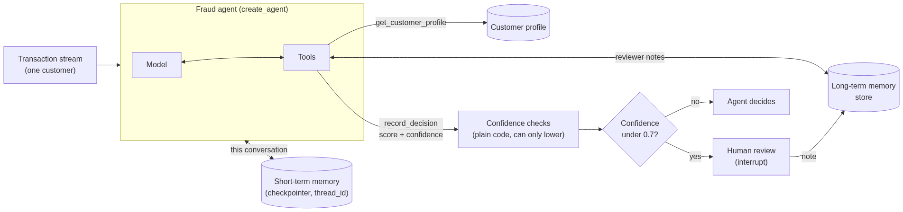

# Transaction Monitoring Workshop

A hands-on tutorial for learning LangChain by building a fraud-monitoring agent with **memory** and **human
review**, then evaluating and improving it with LangSmith.

The agent processes a stream of card transactions for each customer. It remembers earlier transactions
(short-term memory) and what reviewers have told it about the customer (long-term memory). It scores every
transaction, and when it isn't confident, it pauses and asks a human. The model reports its own confidence, and
deterministic checks in code lower it when a human should look anyway, for example a grey-zone score or a large
payment abroad. The checks can add human oversight, but never remove it.



**Difficulty:** easy to medium. All customers and transactions are fictional and offline, stored as JSONL tables
in `data/`; the only network calls are to the model and, in Modules 2 and 3, to LangSmith.

If you'd like to go into more depth, or work through tutorials on your own, check out
[LangChain Academy](https://academy.langchain.com).

## Modules

| Module | What you build | Concepts | Time |
|--------|----------------|----------|------|
| [1. Memory agent](modules/01_memory_agent.ipynb) | The agent: tools, memory, human review | `create_agent`, tools with `ToolRuntime`, checkpointer and threads, store, `interrupt()` | ~30 min |
| [2. Scoring evals](modules/02_scoring_evals.ipynb) | Check the agent's scores against analysts' labels | LangSmith datasets, target functions, evaluators, experiments | ~15 min |
| [3. Annotation queue](modules/03_annotation_queue.ipynb) | Human reviews that improve the eval over time | Annotation queues, feedback, growing datasets, an LLM judge that learns from reviewers | ~20 min |

Module 1 is the core workshop. Modules 2 and 3 are extensions; Module 3 builds on Module 2.

## Setup

Set up the shared Python environment and `.env` file first, by following the
[Setup](../README.md#setup) and [Environment variables](../README.md#environment-variables) sections of the
[top level README](../README.md). All three topics use that one environment.

Then, from this folder, start Jupyter:

```bash
uv run jupyter notebook
```

In VS Code, pick the interpreter at `.venv/bin/python` in the repo root as the notebook kernel.

Don't run a plain `uv sync` inside this folder: it trims the shared environment down to this topic's packages and
breaks the other two. If that happens, run `uv sync --all-packages` from the repo root again. `uv run` and `uv add`
are fine to use here.

| Key | Required for | Get one |
|-----|--------------|---------|
| `LANGSMITH_API_KEY` | Modules 2 and 3, tracing | https://smith.langchain.com |
| `MODEL_NAME` | All modules (optional) | `provider:model` to choose the model. Defaults to `openai:gpt-6-terra`. |
| `ATTENDEE_NAME` | Modules 2 and 3 (optional) | Your name or initials. It's added to your LangSmith dataset and queue names so they don't clash with other attendees' in a shared workspace. Defaults to your computer's username. |

## Switching models

All modules import `model` from `utils/models.py`. It reaches the model through the
[LangSmith LLM Gateway](https://docs.langchain.com/langsmith/llm-gateway-direct-model-access) set up in `.env`, and
uses `openai:gpt-6-terra` by default. You don't need to edit any code or notebooks.

To choose the model, set `MODEL_NAME` as `provider:model` in `.env`, for example:

```bash
# .env
MODEL_NAME=anthropic:claude-sonnet-5-5
```

OpenAI and Anthropic work straight away. For other providers, install their package in this folder first, for
example `uv add langchain-aws` for AWS Bedrock (`bedrock_converse:<model ID>`). Azure OpenAI
(`azure_openai:<deployment>`) works the same way, with its own credentials.

## The data

The bank's data is a set of JSONL files in `data/`: one file per table, one JSON object per line. `utils/db.py`
reads them like a tiny read-only database, and the agent's tools use it to look things up:

```python
from utils import db

db.table("customer_profiles")                       # every row
db.query("transactions", user_id="USR-001")         # the rows that match
db.get("transactions", transaction_id="TX-1003")    # the first row that matches, or None
```

| Table | What's in it | Used by |
|-------|--------------|---------|
| `customer_profiles` | What the bank knows about each customer | `get_customer_profile` tool |
| `transactions` | Every card transaction, including Module 3's week from 19 October | `get_transaction` tool |
| `reviewer_answers` | What a human reviewer says if the agent asks about a transaction | Modules 1 and 2 |
| `analyst_labels` | Reference answers from analysts. The agent never sees them. | Module 2 evals |
| `simulated_annotations` | Reviews to use in Module 3 if you're short on time | Module 3 |

The agent is only ever given a transaction's ID (`New transaction: TX-1003`) and looks up the details itself. Tools
only see the customer in the run's context, so the agent can't read another customer's transactions.

Every query reads the files again, so you can add a transaction or change a profile and run it straight away.

## Run without the notebooks

Modules 1 and 2 each have a `.py` file with the same code as the notebook. Run them from this folder:

```bash
uv run python agent.py                    # Module 1
uv run python -m evals.scoring_evals      # Module 2
```

Module 3 has a step you do in the LangSmith UI, so it's notebook only.

To open the agent in LangGraph Studio:

```bash
uv run langgraph dev
```

In Studio, set the context to `{"user_id": "USR-001"}` and send a transaction ID as a message:

```
New transaction: TX-1003
```

If the agent isn't confident, it pauses. Resume it with `{"decision": "approve", "note": "On holiday in Portugal"}`.

Because `agent.py` imports `model` from `utils.models`, the model your `.env` selects is the one the agent uses
everywhere: in the notebooks, in Studio, and when deployed.

## Project structure

The layout follows standard project structure: `agent.py`, `instructions.md`, `tools/` and `evals/`.
```
02_transaction_monitoring_agent/
├── README.md                    (this file: setup and how to run)
├── pyproject.toml               (dependencies)
├── langgraph.json               (registers agent.py's `agent` for langgraph dev)
├── agent.py                     (the agent's entry point: `build_agent`)
├── instructions.md              (the agent's system prompt)
├── tools/
│   ├── transactions.py          (get_transaction)
│   ├── customers.py             (get_customer_profile)
│   └── decisions.py             (record_decision, and the confidence checks that use the context's settings)
├── data/                        (the bank's database: one JSONL file per table)
│   ├── customer_profiles.jsonl
│   ├── transactions.jsonl
│   ├── reviewer_answers.jsonl
│   ├── analyst_labels.jsonl
│   └── simulated_annotations.jsonl
├── utils/
│   ├── db.py                    (reads the JSONL tables in data/)
│   ├── state.py                 (MyAgentContext: user_id plus the decision settings each run passes to the tools)
│   ├── transaction_processing.py (transaction_stream, process_transactions, decision_log)
│   ├── models.py                (the model every module uses)
│   └── attendee.py              (your name suffix for LangSmith datasets and queues)
├── evals/
│   └── scoring_evals.py         (the evaluators; same code as Module 2)
├── scripts/
│   └── run_experiments.py       (dataset, target function and experiments; runs the baseline and a 0.8 threshold)
├── images/                      (diagrams used by the notebooks)
└── modules/
    ├── 01_transaction_monitoring_agent.ipynb (Module 1)
    ├── 02_scoring_evals.ipynb   (Module 2)
    └── 03_annotation_queue.ipynb (Module 3)
```

## Common issues

**`ModuleNotFoundError` for a package, such as `langchain_anthropic`.** The notebook is running on the wrong
Python. Pick `.venv/bin/python` in the repo root. Check with
`import sys; print(sys.executable)`. If the kernel is right, run `uv sync --all-packages` from the repo root.

**The notebook can't find `agent`, `utils` or `tools`.** Each notebook's setup cell adds the workshop root to
`sys.path`. If you moved a notebook, update the `Path().resolve().parent` line so it points at the
`02_transaction_monitoring_agent` folder.

**`KeyError: 'LANGSMITH_API_KEY'` or `'LC_GATEWAY_KEY'` (or another key).** Your `.env` file is missing or doesn't set that key. Check you
copied `.env.example` to `.env` in the repo root (one level above the `02_transaction_monitoring_agent` folder) and
filled it in.

**`No module named 'utils'` when running a `.py` file.** Run it from the workshop root (this folder), for example
`uv run python agent.py` or `uv run python -m evals.scoring_evals`.

**`mda dev` fails with `KeyError: 'LANGSMITH_API_KEY'`.** MDA reads `.env` from this folder, not the repo root.
Run `cp ../.env .env`.

**Module 3 says to run Module 2 first.** Module 3 adds to the dataset that Module 2 creates. Run Module 2's
notebook (or `uv run python -m evals.scoring_evals`) once, then come back.

**Module 3 finds no reviews.** Reviews only appear after you mark runs as done in the annotation queue. If you're
short on time, set `SIMULATE_ANNOTATIONS = True` in step 3 instead.
