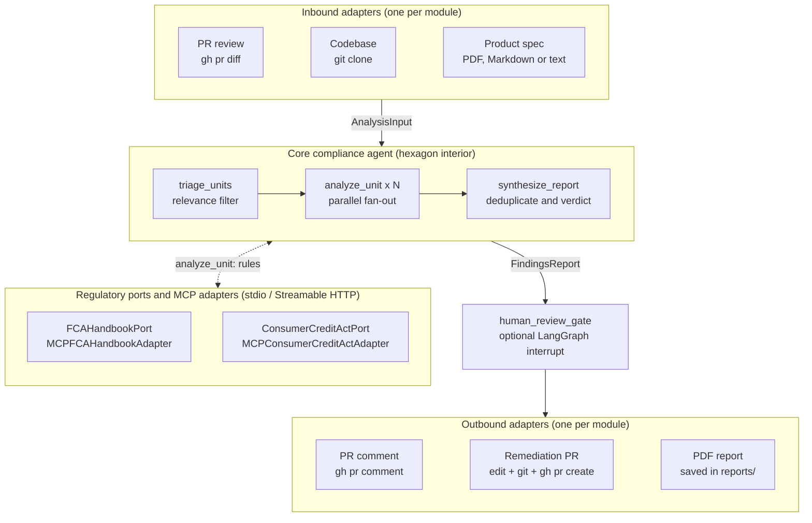
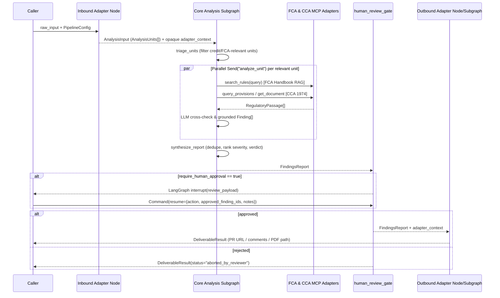
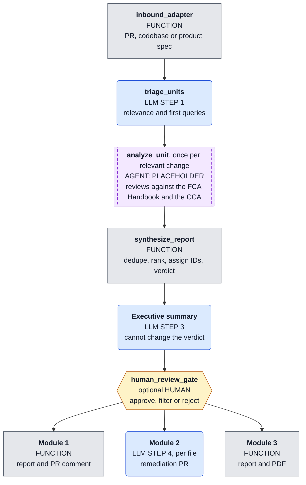
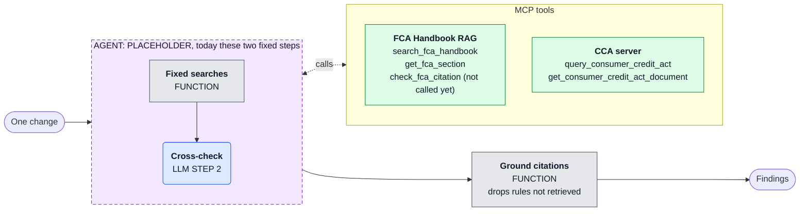
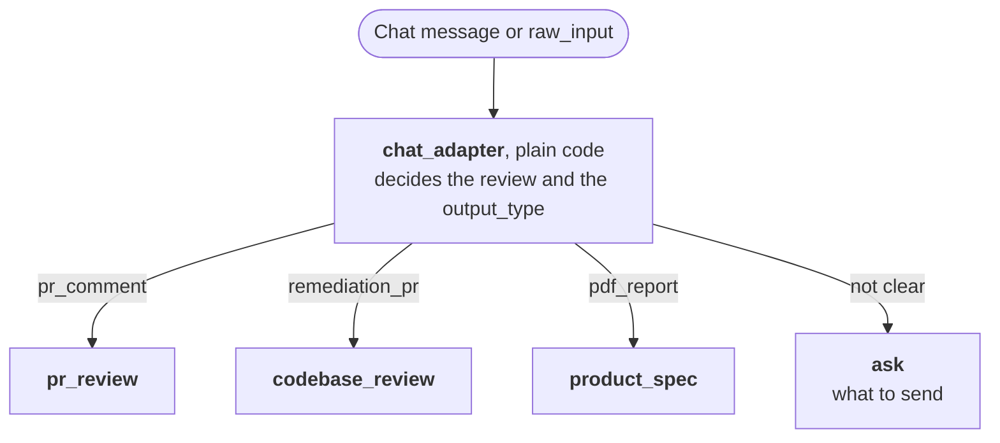

# FCA Handbook & Consumer Credit Act Compliance Agent — Architecture Specification

## 1. Architectural Vision & Principles

This package defines an **encapsulated, reusable compliance analysis agent** built on **Hexagonal Architecture (Ports & Adapters)** and **composable LangGraph subgraphs**.

The core design solves a key asymmetry across compliance use cases:
- **PR Code Review** and **Product Spec Review** produce structured commentary / reports.
- **Existing Codebase Review** must actively edit files, run git operations, and open a remediation Pull Request.

Rather than bloating the compliance reasoning engine with GitHub CLI, Git, or PDF rendering concerns, we separate the lifecycle into **three composable LangGraph stages**:

1. **Inbound Adapter (Node or Subgraph)** — *Artefact Ingestion & Normalisation*  
   Transforms a context-specific input (PR URL, repo URL, PDF path) into a normalised `AnalysisInput` containing self-contained `AnalysisUnit` chunks, plus an opaque pass-through `adapter_context` envelope.
2. **Core Compliance Analysis Agent (Subgraph — Hexagon Interior)** — *Pure Regulatory Analysis*  
   Context-agnostic LangGraph map-reduce subgraph. Triages units for regulatory relevance, queries the **FCA Handbook RAG** and **Consumer Credit Act (CCA)** driven ports in parallel, cross-checks rules against statutory obligations, and synthesises a single typed `FindingsReport`.
3. **Outbound Adapter (Node or Subgraph)** — *Deliverable Producer*  
   Because a compiled LangGraph `StateGraph` is itself a valid LangGraph node, an Outbound Adapter can be either **deterministic** (PDF report generator, `gh pr review` commenter) **or fully agentic** with its own private tools and ReAct loop (e.g., a remediation coding sub-agent that edits files, runs tests, commits, and opens a PR via `gh`).

### Strict Dependency Rule (Inward-Only)

```
adapters/  ──▶  core/  ──▶  ports/  ──▶  domain/
```

- `domain/` depends **only** on Python stdlib + `pydantic` (+ `typing_extensions` / `langgraph` reducer annotations in `state.py`). Zero LLM, MCP, GitHub, or PDF imports.
- `ports/` depends **only** on `domain/`. Defines `Protocol` interfaces for external regulatory tools, LLM reasoning, and I/O adapter nodes.
- `core/` depends **only** on `domain/` and `ports/` (+ `langgraph`). Never imports concrete MCP clients, LangChain model providers, `gh` CLI, Git, or PDF libraries.
- `adapters/` implements `ports/` using real integrations only (MCP clients, LangChain LLM Gateway, GitHub CLI + Code Remediator). Test-only mocks and stubs live exclusively under `tests/fakes.py`.
- `agent.py` (Composition Root) wires concrete adapters into the core pipeline.

---

## 2. System Topology

### 2.1 Hexagonal Architecture Overview



### 2.2 Pipeline Execution & State Flow



### 2.3 Agentic Architecture: Agents, LLM Steps, Functions & Tools

Which parts reason, which parts are plain code, and which parts are tools. **The review of each change against the FCA Handbook and the Consumer Credit Act is a placeholder for an agent that is being built separately.** Until it lands, that step is fixed: code runs the searches and one LLM call judges the results. Triage, the executive summary and each file that Module 2 remediates are single LLM calls. Everything else is code.

`pr_review_agent`, `codebase_review_agent` and `product_spec_agent` are whole pipelines, not agents themselves. `compliance_agent` puts chat in front of all three: see [section 6](#6-combined-graph--output-type).

#### The pipeline

Read from top to bottom. The purple step is expanded in the next diagram.



Two short cuts are left out of the picture: if no change is relevant, triage goes straight to `synthesize_report`, and if a person rejects the report, the gate ends the run. Only the module that was started runs. If its `output_type` is `report`, it delivers only the report.

#### Inside `analyze_unit`



| Kind | Colour | What it means here | Parts |
|---|---|---|---|
| **Agent** | Purple, dashed | A model chooses its own tools and next step, in a loop | None built yet. Placeholder: the review in `analyze_unit` |
| **LLM step** | Blue | One model call with a fixed prompt and no tools | `triage_units`, the cross-check in `analyze_unit` (until the agent replaces it), the summary in `synthesize_report`, and `LangChainCodeRemediator` in Module 2 |
| **Function** | Grey | Plain code, no model | Inbound and outbound adapters, routing, retrieval, grounding citations, ranking, verdict, report |
| **Tool** | Green | Read-only, called over MCP (`handbook_rag` via `FCA_MCP_URL` / default `http://127.0.0.1:8765/mcp`; `fca-regulatory-mcp` via `CCA_MCP_URL` / stdio) | `search_fca_handbook`, `get_fca_section`, `check_fca_citation`, `query_consumer_credit_act`, `get_consumer_credit_act_document` |
| **Human** | Amber | A person decides. Off by default (`require_human_approval=False`), so reports are auto-approved. From chat, it is on for anything that writes to GitHub | `human_review_gate` |

**For the agent that fills the placeholder:** `FCAHandbookResearchPort` (`ports/regulatory.py`), which `MCPFCAHandbookAdapter` implements, offers `search` (breadth, snippets), `get_section` (depth, a whole section in order) and `check_citation` (is the quote word for word, and is the provision binding). Failures raise `MCPToolError`, so an error is never mistaken for a rule. Code should still check every quote after the agent answers.

---

## 3. Domain Model & State Contracts

### 3.1 Pass-Through `adapter_context` Envelope

A subtle hexagonal problem: the **Codebase Inbound Adapter** clones a repository to `/tmp/work-abc123` (or the **PR Inbound Adapter** resolves `owner/repo`, `pr_number`, and `head_sha`). The Core Agent has no business knowing about filesystem paths or commit SHAs, **yet** the Outbound Adapter needs them to apply edits or post inline PR comments.

**Solution:** `PipelineState` carries a top-level `adapter_context: dict[str, Any]` that flows directly from `inbound_adapter` → `outbound_adapter` and is **never passed into or read by the Core Analysis Subgraph**.

### 3.2 Normalised Input Contract (`AnalysisInput` & `AnalysisUnit`)

Every Inbound Adapter produces an `AnalysisInput`:

| Field | Type | Purpose |
|---|---|---|
| `target_id` | `str` | Unique identifier for the analysed artefact (e.g. `org/repo#42`, `spec-v2.pdf`) |
| `source_type` | `SourceType` | `"pr_review" \| "codebase" \| "product_spec" \| "custom"` |
| `title` | `str` | Human-readable title of the PR, repo, or specification |
| `summary` | `str` | High-level manifest / README / PR description / executive overview |
| `regulatory_scope` | `list[str]` | Optional focus hints (e.g. `["CONC", "PRIN 2A", "CCA 1974"]`) |
| `units` | `list[AnalysisUnit]` | Discrete chunks (diff hunks, source files/modules, PDF sections) |

Each `AnalysisUnit` carries a **discriminated union `location: EvidenceLocation`** so downstream adapters get exact native anchors without the Core knowing adapter internals:
- `PullRequestDiffLocation` — `file_path`, `hunk_header`, `start_line`, `end_line`, `diff_position`
- `CodeLocation` — `file_path`, `start_line`, `end_line`, `symbol_name`
- `DocumentLocation` — `document_name`, `page_start`, `page_end`, `section_heading`
- `GenericLocation` — `reference`

### 3.3 Core Output Contract (`FindingsReport` & `Finding`)

The Core Analysis Subgraph outputs a single `FindingsReport`:
- **`report_id`**, **`target_id`**, **`source_type`**, **`generated_at`**
- **`overall_verdict`**: `"compliant" | "compliant_with_observations" | "non_compliant" | "requires_manual_review"`
- **`executive_summary`**: Concise synthesis of key risks and FCA/CCA alignment
- **`findings: list[Finding]`** — each `Finding` includes:
  - `finding_id`: Stable ID (used by HITL review filtering and deduplication)
  - `unit_id`: Originating `AnalysisUnit.unit_id`
  - `title`, `description`, `severity` (`critical | high | medium | low | info`), `status` (`non_compliant | potential_breach | needs_review | observation`)
  - `location`: Anchored `EvidenceLocation` copied/refined from the analysed unit
  - `evidence_excerpt`: Verbatim snippet from the analysed artefact
  - `fca_citations: list[RegulatoryCitation]` (e.g., `CONC 4.2.5R`, `PRIN 2A.3`)
  - `cca_citations: list[RegulatoryCitation]` (e.g., `CCA 1974 s.55`, `CCA 1974 s.75`)
  - `fca_vs_cca_comparison`: Explicit analysis of how FCA Handbook rules and Consumer Credit Act provisions align, overlap, or create dual obligations for this finding
  - `remediation_guidance`: Concrete, actionable guidance (consumed directly by PDF/PR adapters and as the specification for Module 2's coding sub-agent)
  - `suggested_change`: Optional concise code/text snippet suggestion
  - `confidence`: `0.0`–`1.0`
- **`units_total`**, **`units_triaged_in`**, **`units_skipped`**, **`regulatory_queries_executed`** (full auditability)

---

## 4. Port Contracts

### 4.1 Driven Regulatory Ports (`ports/regulatory.py`)

Both external regulatory sources are abstracted behind async Python `Protocol`s so the Core never depends on MCP transport details or tool schemas:

```python
class FCAHandbookPort(Protocol):
    async def search_rules(
        self,
        query: str,
        *,
        sourcebooks: list[str] | None = None,
        top_k: int = 5,
    ) -> list[RegulatoryPassage]: ...

    async def get_rule(self, reference: str) -> RegulatoryPassage | None: ...


class ConsumerCreditActPort(Protocol):
    async def query_provisions(
        self,
        query: str,
        *,
        sections: list[str] | None = None,
        top_k: int = 5,
    ) -> list[RegulatoryPassage]: ...

    async def get_document(
        self,
        section: str | None = None,
    ) -> list[RegulatoryPassage]: ...
```

Notice why `ConsumerCreditActPort` exposes **both** `query_provisions(...)` and `get_document(section=None)`:
- If the other team ships a RAG/search MCP tool for CCA, `MCPConsumerCreditActAdapter` wires `query_provisions` to it.
- If they ship a full-Act or section-fetch MCP tool, `MCPConsumerCreditActAdapter` wires `get_document` to it (and can fall back seamlessly between them).
- Zero core code changes either way.

### 4.2 MCP Server Integration Contract (For the Regulatory Tool Team)

Our `MCPFCAHandbookAdapter` and `MCPConsumerCreditActAdapter` in `adapters/regulatory/mcp.py` support **both `stdio` and `streamable_http` MCP transports** via a declarative `MCPServerConfig` + `MCPToolMapping`:

```python
MCPServerConfig(
    transport="streamable_http",          # or "stdio"
    url="http://localhost:8001/mcp",      # for streamable_http
    # command="uv", args=["run", ...],    # for stdio
    headers={"Authorization": "Bearer ..."},
)
```

**Checklist to agree with the MCP team once their servers are ready:**
1. Transport type (`stdio` command/args vs `streamable_http` URL + auth headers).
2. Exact MCP tool name(s) for FCA Handbook RAG and Consumer Credit Act lookup/document fetch.
3. Input argument names (e.g., `query`, `top_k`, `sourcebook`, `section`).
4. Output payload shape (JSON list of objects vs plain text markdown) so our configurable response parser maps cleanly into `RegulatoryPassage(source, reference, title, text, url, score)`.

### 4.3 Pluggable I/O Adapter Contracts (`ports/adapters.py`)

Any callable (sync/async function) **or compiled LangGraph `StateGraph`** matching the `PipelineState` slice contract can be plugged in:

- **Inbound Adapter Node**: Reads `raw_input` (and optional `config`), returns `{"analysis_input": AnalysisInput, "adapter_context": dict}`.
- **Outbound Adapter Node / Subgraph**: Reads `findings_report`, `analysis_input`, `adapter_context`, and `human_review`, executes whatever deterministic or agentic tool calls it needs, and returns `{"deliverable_result": DeliverableResult}`.
- **`ContextModule`**: A small frozen bundle `(name, inbound_node, outbound_node, description)` representing one complete interchangeable I/O pairing.

---

## 5. Core LangGraph Subgraph & HITL Gate

### 5.1 Core Subgraph Nodes (`core/graph.py`)

1. **`triage_units`**: Evaluates each `AnalysisUnit` in `analysis_input.units` to filter out noise (e.g. formatting-only diffs, lockfiles, boilerplate legal disclaimers) and generate targeted FCA + CCA search queries per relevant unit.
2. **Parallel Fan-Out (`Send("analyze_unit", ...)`)**: LangGraph dispatches one isolated `UnitAnalysisState` branch per relevant unit in parallel. An agent built separately will replace this step (see 2.3). Today each:
   - Calls `FCAHandbookPort.search_rules(...)` and `ConsumerCreditActPort.query_provisions(...)` / `get_document(...)` concurrently (`asyncio.gather`).
   - Invokes `ComplianceAnalyzerPort.analyze_unit(unit, fca_passages, cca_passages)` to cross-check the artefact against both regulatory texts and produce grounded `Finding` items.
   - Results merge into `PipelineState` / `CoreAnalysisState` via an append reducer (`Annotated[list[Finding], operator.add]`).
3. **`synthesize_report`**: Deduplicates overlapping findings across units, sorts by severity (`critical` → `info`), assigns stable IDs (`F-001`, `F-002`, ...), computes the `overall_verdict`, lists any part of the scope the FCA index does not hold (`scope_not_searched`; if that is all of the FCA scope, the verdict is at best `requires_manual_review`), and generates the `executive_summary` to emit the final `FindingsReport`.

### 5.2 Optional Human-in-the-Loop Gate (`human_review_gate`)

- Controlled by `PipelineConfig.require_human_approval: bool` (default `False`).
- When `False`: passes straight through to `outbound_adapter`.
- When `True`: calls LangGraph `interrupt(...)` with a concise review payload (verdict, executive summary, finding IDs/titles/severities).
- Resuming with `Command(resume=...)` supports:
  - `{"action": "approve", "notes": "..."}` — forward all findings to `outbound_adapter`.
  - `{"action": "filter", "approved_finding_ids": ["F-001"], "notes": "..."}` — filter `findings_report.findings` to only approved findings before invoking `outbound_adapter`.
  - `{"action": "reject", "notes": "..."}` — skip `outbound_adapter` and terminate cleanly with `DeliverableResult(status="aborted_by_reviewer")`.

---

## 6. Combined Graph & Output Type

`compliance_agent` (`adapters/chat.py`) is the one graph that Studio shows. The three pipelines run inside it, unchanged.



Any of them can also be `report`. `output_type` is a field of `PipelineState`, next to `adapter_context`. An inbound adapter
sets it with `decide_output_type` (`adapters/output_type.py`), the human review gate shows it, the outbound adapter delivers
it, and `DeliverableResult.output_type` records it. The core subgraph does not have the field.

From chat, an output that writes to GitHub always waits at the human review gate. Each turn clears the previous turn's input.

---

## 7. Blueprints for Future I/O Modules

| Module | Inbound Adapter (Node/Subgraph) | `adapter_context` Passed Through | Outbound Adapter (Node/Subgraph) |
|---|---|---|---|
| **1. PR Code Review** | Runs `gh pr view --json ...` & `gh pr diff`; parses diff hunks into `AnalysisUnit`s with `PullRequestDiffLocation` | `{repo, pr_number, head_sha, pr_url}` | Formats `FindingsReport` into inline review comments anchored on `file_path` + `end_line` + summary review body via `gh api` / `gh pr review` |
| **2. Existing Codebase Review** | Clones default branch via `git clone --depth 1`; filters/chunks relevant source files into `AnalysisUnit`s with `CodeLocation` | `{repo_url, default_branch, workspace_path, base_sha}` | **Agentic Remediation Subgraph** (`StateGraph` with ReAct tool loop: `read_file`, `edit_file`, `run_tests`, `git_checkout_commit`, `gh pr create`) applying fixes for each `Finding` and opening a remediation PR |
| **3. Product Spec Review** | Extracts text & page/heading structure from incoming PDF into `AnalysisUnit`s with `DocumentLocation` | `{input_pdf_path, output_pdf_path}` | Renders `FindingsReport` (executive summary, severity matrix, FCA/CCA citation table, per-section recommendations) into a formatted PDF report |
